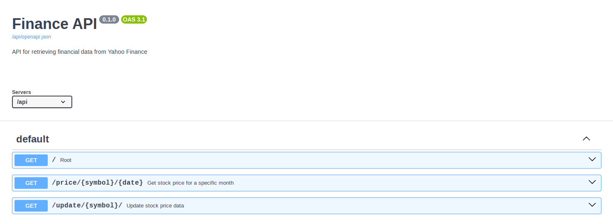

https://finance.marcodifrancesco.com/api/docs/

## Kubernetes Build & Deploy

```bash
docker build -t localhost:5000/finance-api:latest .
docker push localhost:5000/finance-api:latest
kubectl rollout restart deployment/finance-api -n finance
```

## Production

```bash
docker compose up
```

## Development

```bash
docker compose -f docker-compose.yaml -f docker-compose.dev.yaml up
```
